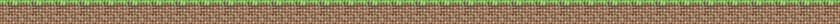
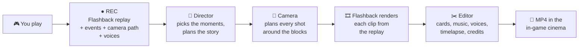

<div align="center">




<a href="#what-it-does"></a>
<a href="#gallery"></a>
<a href="#install"></a>
<br>
<a href="#how-it-works"></a>
<a href="#build"></a>
<a href="#ru"></a>

<br><br>


</div>

Play the way you always do. Survival Cinema records in the background, notices what matters — your first diamonds,
the night you nearly died, the moment everyone started yelling on voice chat — and when you are ready it shoots and
edits a real film of it: cinematic camera moves, chapter cards, music, a timelapse of your base growing and end credits
with your world's stats. It plays right inside Minecraft, in a little cinema, and it is a normal MP4 you can share.



<a id="what-it-does"></a>


|  |  |
|---|---|
| 🎬 **Finds the best moments** | Advancements, first trips to the Nether and the End, boss fights and the Ender Dragon, deaths and near-deaths, kill streaks, rare finds, building sprees, elytra flights, big falls, the first night. |
| 🎙️ **Voices first** | A big moment *and* people shouting beats everything else. Quiet talks get a two-shot; a talk after the dragon closes the film. Voices stay at normal speed over slow motion. |
| 🎥 **Cinematic cameras** | Orbits, side shots, pull-backs, over-the-shoulder, two-shots and slow motion — planned along your recorded path, kept out of walls and leaves, following you down a mine. |
| 📖 **Chapters** | "Day 1", "Days 4–6", "The Nether", "The End" — title cards in Minecraft's own font. |
| 🏠 **Your base, growing** | The place you kept coming back to is found automatically and shown going up, day by day, as a timelapse. |
| 🎵 **Music** | Minecraft's soundtrack from your game files or your own tracks, ducked under voices and loud moments. |
| 🏆 **Credits** | Days survived, blocks placed, mobs defeated, diamonds found, deaths — and everyone who played with you. |
| 🍿 **In-game cinema** | The film plays the moment it is ready: pause, seek, volume. Stop shooting with Esc and continue later — even after a crash. |

<a id="gallery"></a>


<table>
  <tr>
    <td></td>
    <td></td>
  </tr>
  <tr>
    <td align="center"><sub>After the Ender Dragon, the film is offered</sub></td>
    <td align="center"><sub>The opening title</sub></td>
  </tr>
  <tr>
    <td></td>
    <td></td>
  </tr>
  <tr>
    <td align="center"><sub>Chapter cards in Minecraft's font</sub></td>
    <td align="center"><sub>Your base, growing day by day</sub></td>
  </tr>
  <tr>
    <td></td>
    <td></td>
  </tr>
  <tr>
    <td align="center"><sub>One calm screen while the film is shot</sub></td>
    <td align="center"><sub>End credits with your world's stats</sub></td>
  </tr>
</table>

<a id="install"></a>


1. Minecraft **1.21.11** with **Fabric Loader 0.18+** and **Fabric API**.
2. **[Flashback](https://modrinth.com/mod/flashback) 0.39.10** or a newer 0.39.x — the replay engine Survival Cinema films with.
3. Drop the Survival Cinema jar into `mods`.
4. Optional: [Simple Voice Chat](https://modrinth.com/plugin/simple-voice-chat) for voices, [Mod Menu](https://modrinth.com/mod/modmenu) for the settings button.

<p align="center"><a href="https://modrinth.com/mod/flashback"></a></p>

Client-side only — works on any server, vanilla or modded, and with Sodium, Iris, Lithium and the rest of Fabulously Optimized.

> [!NOTE]
> On Windows 11 (and Windows 10 build 20348+) calls in **Discord, Telegram, TeamSpeak, Zoom, WhatsApp and Skype** can be
> recorded too, plus your microphone. Voices are only recorded in worlds where you tick *Record voices* — and your friends
> see no sign in Discord, so tell them.

<a id="how-it-works"></a>




| Module | What lives there |
|---|---|
| [`src/main`](src/main/java/com/survivalcinema) | The director, without Minecraft: event scoring, the story planner, the edit decision list, camera paths and the occlusion solver, the base finder and timelapse planner. Pure Java, fully unit-tested. |
| [`src/client`](src/client/java/com/survivalcinema/client) | Everything in the game: recording, watchers for events and voices, the render pipeline that drives Flashback, the film editor (FFmpeg via JavaCV), the cinema and all the screens. |
| [`src/test`](src/test/java/com/survivalcinema) | Unit tests, including camera tests on real terrain saved from films. |
| [`src/gametest`](src/gametest/java/com/survivalcinema/gametest) | End-to-end tests in a real client — among them a **bot that plays a whole survival** (house, mine, Nether, elytra, the dragon) with real keys and makes the film. |

<a id="build"></a>


Requires JDK 21.

```bash
./gradlew build
```

The jar lands in `build/libs/`. Other useful tasks:

| Command | What it does |
|---|---|
| `./gradlew runClient` | A dev client with Flashback and Simple Voice Chat. |
| `./gradlew test` | The unit tests. |
| `./gradlew runPlayTest` | The bot plays two sessions, kills the dragon and makes a film (~15 min, opens a game window). |
| `./gradlew runFilmTest` | Shoots a short film from the recordings in `run/`. Add `-Preshoot=<world>/<film> -Pclips=3,5` to shoot chosen clips of a film again. |


Everything stays on your computer. Survival Cinema uploads nothing and has no servers. It asks before recording each
world, and *Disk space* shows and deletes your recordings and films.

<a id="ru"></a>


**Survival Cinema** сам превращает твоё выживание в фильм. Играешь как обычно, мод записывает в фоне и замечает главное:
первые алмазы, ночь, когда ты чуть не умер, момент, когда все заорали в голосовом. Когда захочешь, он снимает и монтирует
настоящий фильм на 5, 10, 15 или 20 минут: кинематографичная камера, главы, музыка, таймлапс базы, титры со статистикой
мира. Фильм играет прямо в игре, в маленьком кинотеатре, и сохраняется обычным MP4. Нужны Fabric, Fabric API и
[Flashback](https://modrinth.com/mod/flashback). Интерфейс на английском и русском.


<p align="center"><sub>Released under the <a href="LICENSE">MIT license</a>.</sub></p>
