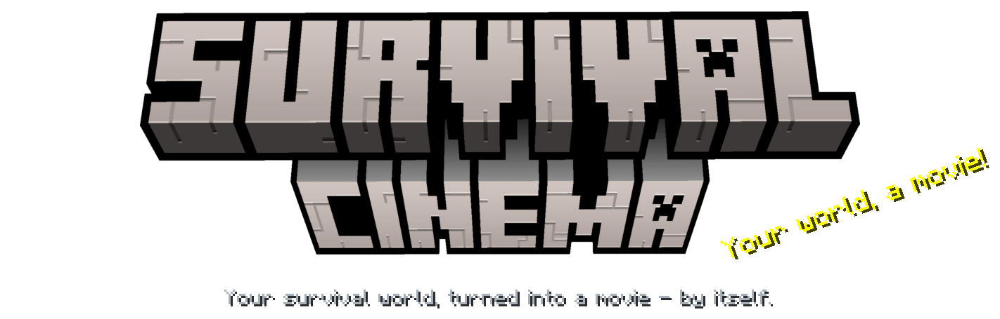
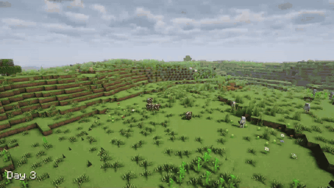
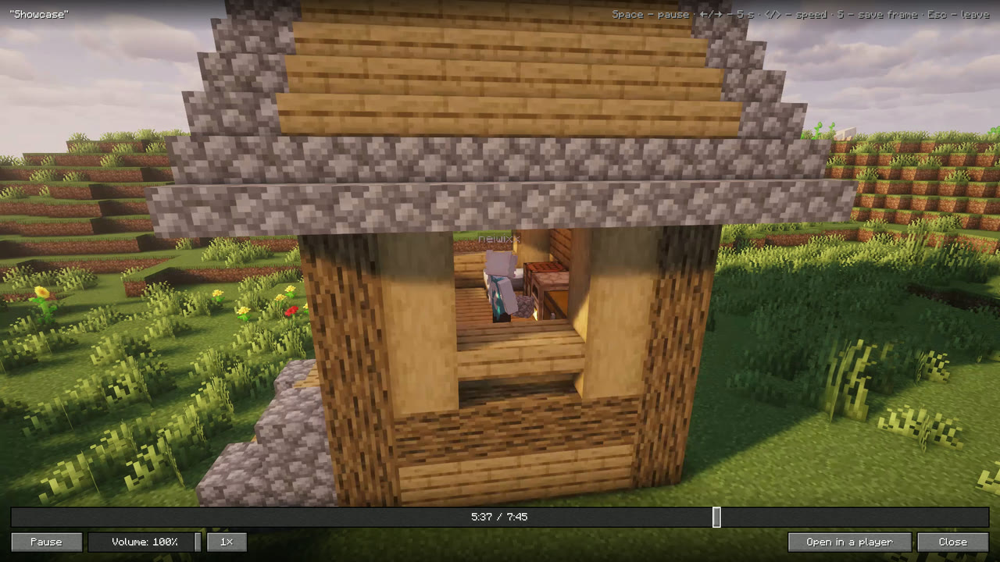
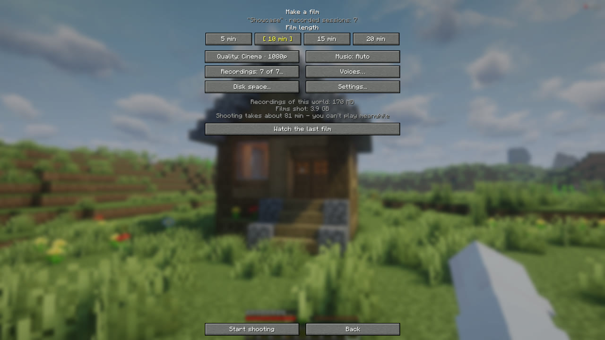
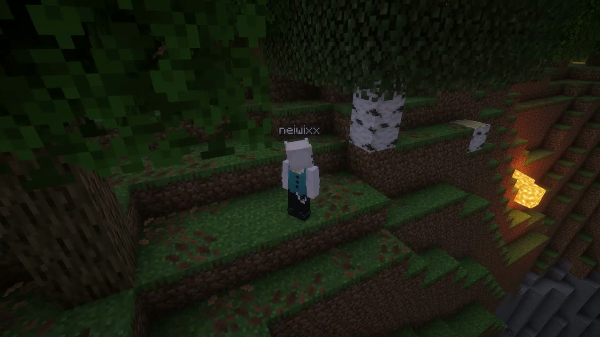
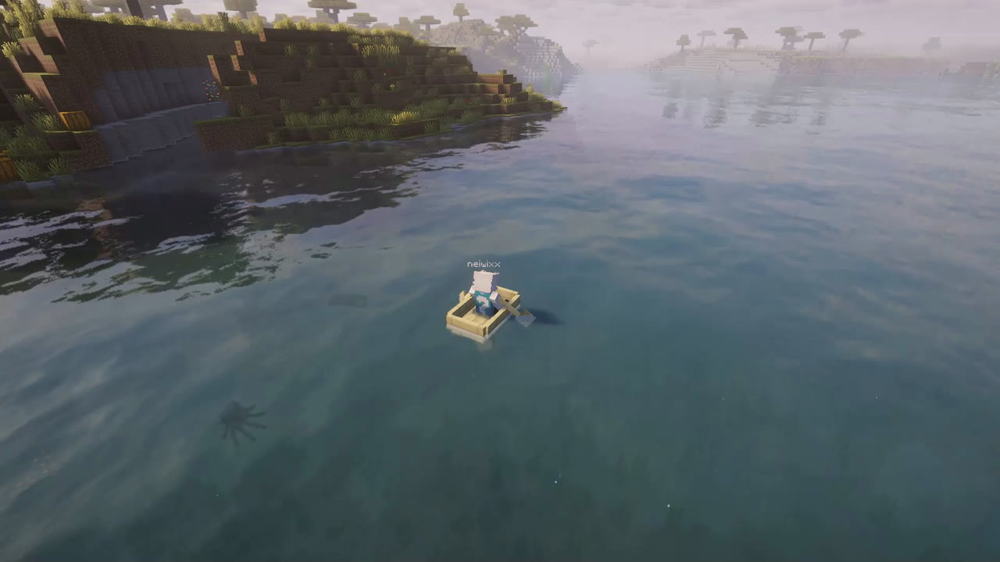
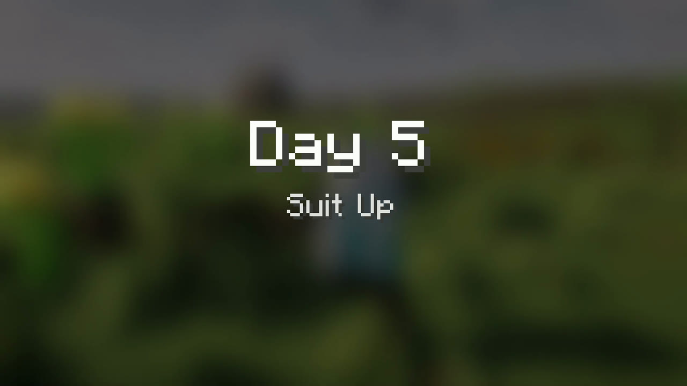

<p align="center"></p>


**Play your survival. It makes the movie.**

Survival Cinema records your world in the background and edits the best moments into a real film: the first tree, the night you nearly died, the shore you sailed to, your first diamonds, the dragon. Cameras, chapters, music, a timelapse of your base and end credits, all made by itself. You watch it right inside Minecraft, and it's a normal MP4 you can share.


### A director, not a highlight reel
- Picks the moments that matter and tells them as a story, day by day
- Chapter cards that type themselves out, cinematic cameras, slow motion on big moments
- Your friends' voices from Simple Voice Chat or a Discord call, the loudest moments first

### Your base, growing
- A timelapse of your house from the first block to the roof



### A cinema in the game
- Plays the film full screen: pause, seek, speed from 0.5x to 2x, save any frame as a picture




1. **Play** the way you always do. A small ● REC sits in the corner.
2. **Kill the dragon**, or press the clapperboard in the pause menu any time.
3. **Pick 5, 10, 15 or 20 minutes** and press *Start shooting*.
4. **Watch.** The film plays by itself when it's ready.




| Mod | Status | Note |
|---|---|---|
| Minecraft 1.21.11 + Fabric API | ✅ Required | |
| [Flashback](https://modrinth.com/mod/flashback) 0.39.10+ | ✅ Required | Records and films your world |
| [Simple Voice Chat](https://modrinth.com/plugin/simple-voice-chat) | ➕ Optional | Friends' voices in the film |
| [Mod Menu](https://modrinth.com/mod/modmenu) | ➕ Optional | Settings button |







**Does it need to be on the server?**
No. It's fully client-side and works on any server or in single player.

**How long does shooting take?**
It depends on the quality: about the film's own length in Draft, longer in Cinema 1080p. The game tells you before you start, and you can stop and go on later.

**Where is the film?**
In `.minecraft/survivalcinema/films`, as a normal MP4. *Open in a player* plays it in your usual video player.

**Does it slow down my game while I play?**
Hardly: while you play it only records, like Flashback does. The heavy part is shooting the film, when you choose to.


Requires JDK 21. The jar lands in `build/libs/`.

```bash
./gradlew build
```

`./gradlew runPlayTest` lets a bot play a whole survival and make the film by itself.


🎬 Open source under the [MIT license](LICENSE). Bug reports and ideas are welcome in [Issues](https://github.com/neiwix/SurvivalCinema/issues).

An addon for [Flashback](https://modrinth.com/mod/flashback) by Moulberry. Not affiliated with Flashback's author or Mojang.
